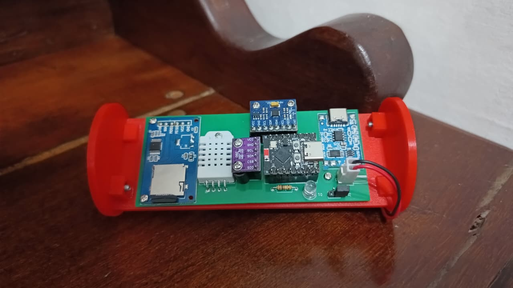
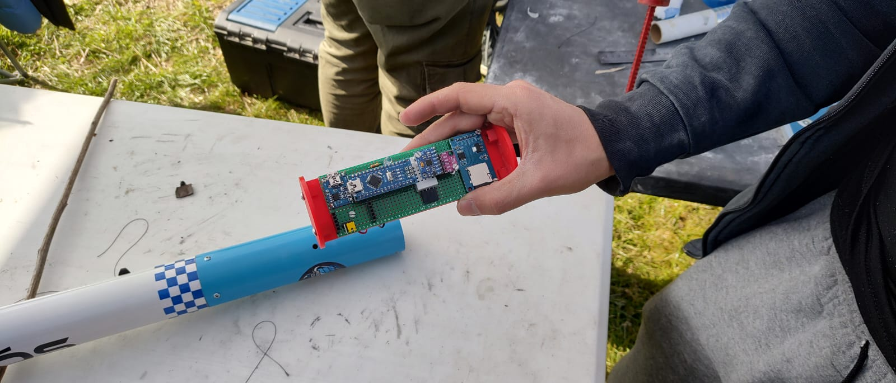
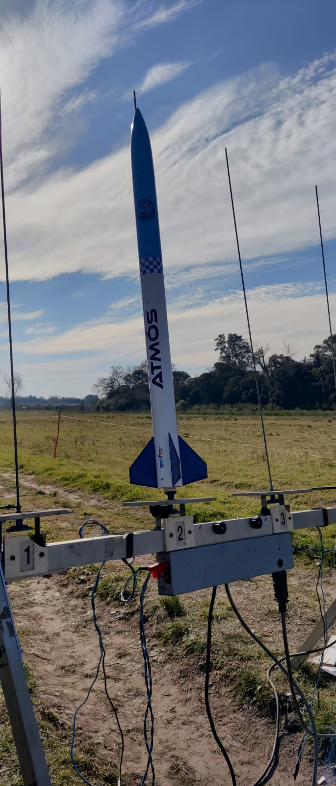
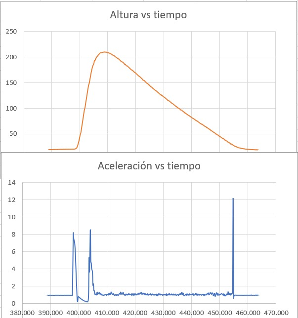

# On-Board-Computer_Scale-Rocket
An on-board computer for scale rockets that logs real-time data (temperature, humidity, pressure, altitude, tilt, and acceleration) to an SD card.

## 📸 Gallery

## 🎯 Main Featrues
- Real-Time Processing ESP32.
- Data stored on a micro SD Card.
- 2-hour battery life with a 14500 battery.
- Temperature, Humidity, Pressure, Altitude, Tilt and Acceleration measurements.

## 🛠️ Technology
- **Microcontroller:** ESP32-C3-Supermini
- **Sensors:** BMP280, MPU6050, DHT22
- **IDE:** Arduino IDE / C - C++
- **PCB Design:** KiCad

## 💡 Architecture and Technical Challenges

### 🔄 Multi-Core Real-Time Processing (FreeRTOS Task Scheduling)
To prevent slow storage operations from bottlenecking high-frequency sensor reads, the system leverages FreeRTOS multi-threading:
- **Core Loop (Data Acquisition):** Reads the BMP280, MPU6050, and DHT22 sensors without blocking execution. Sensor frames are instantly pushed to an asynchronous `FreeRTOS Queue` (`xQueueCreate`).
- **Dedicated SD Worker Task (`sdTask`):** Pinned to a separate core, this background task pops data frames from the queue, formats them into a CSV structure, and performs bulk writes to the microSD card. Periodic flushing (`dataFile.flush()`) occurs every 500ms to balance flash endurance with data security in the event of an abrupt landing or power loss.

### 📊 Dynamic Calibration and Orientation Vectoring
- **Self-Calibrating Ground Pressure:** During `setup()`, the flight computer captures the baseline ground pressure (`initPres`). Relative altitude is computed dynamically on-flight using barometric reduction formulas, featuring an automatic recalibration floor to eliminate negative altitude drifts due to noise.
- **Normalized Tilt Angle Calculation:** Acceleration vector components ($a_x, a_y, a_z$) are processed to derive the total G-force magnitude (Euclidean norm: $\sqrt{a_x^2 + a_y^2 + a_z^2}$). Using normalized directional cosines, the code computes the absolute rocket tilt angle relative to the primary longitudinal axis ($A_y$), providing accurate attitude telemetry independent of translation.
- **Asynchronous Sampling Rates:** Fast-changing parameters (tilt, acceleration, altitude) are sampled at high frequencies (~20 ms), while slower thermal dynamics (DHT22) are queried asynchronously via non-blocking timers every 2000 ms to avoid sensor bus hangs.

### 💾 File System & Data Integrity Strategy
- **Automatic Flight Session Indexing:** On boot, the system sweeps the root directory of the SD card to identify existing log files (`/Vuelo_X.csv`) and automatically increments the index to create a new session log. This eliminates accidental data overwrites between consecutive launches.
- **Localized CSV Formatting:** Data strings dynamically adapt decimal precision and parse dot separators into comma-separated values (`.` $\rightarrow$ `,`), ensuring raw telemetry can be directly imported into statistical analysis tools and spreadsheet software without pre-processing.

## 🚀 Launch Tests & Demonstration

